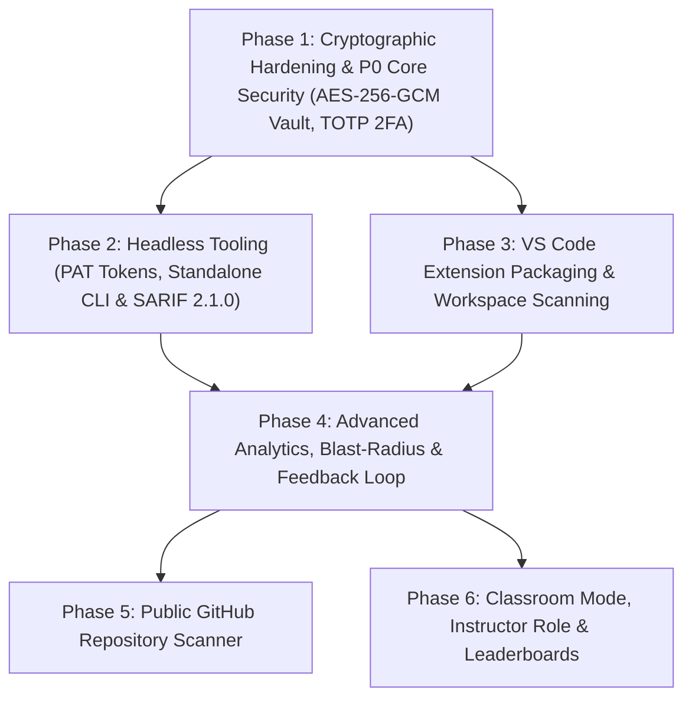

# LeakLens — God-Level Specification: Next Phase Plan

This document establishes the step-by-step engineering roadmap to transition LeakLens from its current verified baseline (33 passed tests) to full compliance with the Master Specification.

---

## Roadmap Overview & Phases



---

## Detailed Phase Breakdown

### Phase 1: Cryptographic Hardening & Incomplete P0 Security
*Focus: Upgrade encrypted vault to AES-256-GCM with Scrypt KDF, create portable `.leaklens` file format, and add optional RFC 6238 TOTP 2FA.*

- **Target Files:**
  - `engine/store.py`: Implement AES-256-GCM authenticated encryption/decryption (or AES-GCM via Python standard/`cryptography` if available, or authenticated ChaCha20/GCM construct); add `totp_secret` and `recovery_codes` columns to `users` table; implement portable `.leaklens` JSON/binary export.
  - `app.py`: Routes `/api/vault/export`, `/api/vault/import`, `/api/auth/2fa/setup`, `/api/auth/2fa/verify`.
  - `templates/index.html`, `static/app.js`: 2FA setup modal with secret key and OTP verification form; Export/Import buttons on Vault tab.
- **Dependencies Required:** Standard library (`hashlib`, `hmac`, `secrets`, `base64`) or lightweight `cryptography` for standard AES-256-GCM; pure Python TOTP algorithm (RFC 6238) requiring zero external dependencies.
- **Test Cases:**
  - `test_aes_gcm_vault_encryption`: Roundtrip encrypt and decrypt, tamper test (invalid tag triggers rejection).
  - `test_portable_leaklens_vault_export_import`: Verify file portability across sessions.
  - `test_totp_2fa_workflow`: Setup secret, generate valid code, verify login rejection with bad OTP and acceptance with valid OTP.
- **Complexity:** Medium (3–4 hours)
- **Acceptance Criteria:** Vault records use authenticated encryption with unique nonces; user can optionally enable 2FA and download `.leaklens` files.

---

### Phase 2: Headless Tooling (PAT Tokens, Standalone CLI & SARIF 2.1.0)
*Focus: Allow developers and CI pipelines to run LeakLens without browser interaction.*

- **Target Files:**
  - `engine/store.py`: Add `api_tokens` table (`token_hash`, `user_id`, `name`, `created_at`, `expires_at`, `scopes`).
  - `app.py`: Bearer token authentication middleware; `/api/v1/scan` headless endpoint; `/api/tokens` management.
  - `engine/sarif.py`: Converter mapping internal findings to official SARIF 2.1.0 JSON format.
  - `cli.py`: Standalone CLI tool with commands:
    ```bash
    leaklens scan <path> [--format json|sarif|text] [--threshold high|med|low]
    leaklens vault export <file>
    ```
- **Dependencies Required:** Standard library (`argparse`, `sys`, `json`, `pathlib`).
- **Test Cases:**
  - `test_pat_token_authentication`: Verify access with valid Bearer PAT, rejection with invalid token.
  - `test_sarif_export_schema`: Ensure output validates against SARIF 2.1.0 schema rules.
  - `test_cli_scan_exit_codes`: Test CLI exit code 1 on active leaks, exit code 0 on clean code.
- **Complexity:** Medium (3–4 hours)
- **Acceptance Criteria:** `python cli.py scan samples/` outputs colored text or SARIF and sets appropriate exit code for CI/CD gates.

---

### Phase 3: VS Code Extension Verification & Workspace Scanning
*Focus: Transition the extension from code simulation to an installable package.*

- **Target Files:**
  - `ide-extension/src/extension.ts`: Add `leaklens.scanWorkspace` command scanning all unignored files in workspace; add progress reporting.
  - `ide-extension/package.json`: Add build and packaging scripts (`vsce package`).
  - `scripts/leaklens-pre-commit.py`: Add automated unit test in `tests/test_hooks.py`.
- **Dependencies Required:** Node.js / `npm` (developer environment for compiling `.vsix`).
- **Test Cases:**
  - `tests/test_hooks.py`: Create temporary git repository, stage file with fake secret, run hook, assert commit blocked.
- **Complexity:** Low-Medium (2 hours)
- **Acceptance Criteria:** `.vsix` file is built and ready for drag-and-drop installation into VS Code; pre-commit hook has automated test coverage.

---

### Phase 4: Advanced Analytics, Blast-Radius & Feedback Loop
*Focus: Deepen explainability and user intelligence.*

- **Target Files:**
  - `engine/catalog.py`: Add specific blast-radius scopes per credential type (e.g., Stripe: charges, refunds; AWS: S3, IAM, EC2).
  - `app.py`: `/api/feedback` endpoint for reporting false positives / false negatives.
  - `engine/store.py`: Add `feedback` table.
  - `templates/index.html`, `static/app.js`: Add "Report False Positive" button on finding cards; add provider-level breakdown charts on User Dashboard.
- **Dependencies Required:** None (uses existing frontend SVG and store).
- **Test Cases:**
  - `test_blast_radius_metadata`: Verify every provider credential includes concrete blast-radius information.
  - `test_feedback_submission`: Verify feedback submission and storage in database.
- **Complexity:** Low (2 hours)
- **Acceptance Criteria:** Dashboard shows provider distribution chart; finding card displays "Potential Blast Radius: ..." and feedback button.

---

### Phase 5: Public GitHub Repository Scanner
*Focus: Scan open-source repositories by URL.*

- **Target Files:**
  - `engine/github_scanner.py`: Shallow clone (`git clone --depth 1`) into temporary isolated sandbox with strict timeout and size cap (15MB).
  - `app.py`: Route `POST /api/scan/github` accepting `{"repo_url": "https://github.com/..."}`.
  - `templates/index.html`, `static/app.js`: "Scan GitHub Repo" input tab.
- **Dependencies Required:** System `git` binary (already present on system).
- **Test Cases:**
  - `test_github_url_sanitization`: Verify malicious URL arguments (e.g. `--upload-pack`) are rejected.
  - `test_github_scan_sandbox`: Verify temp clones are cleaned up after scan.
- **Complexity:** Medium (2–3 hours)
- **Acceptance Criteria:** Users can paste a public GitHub URL and receive a LeakLens scan summary.

---

### Phase 6: Classroom Mode, Instructor Role & Leaderboards
*Focus: College and educational team environments.*

- **Target Files:**
  - `engine/store.py`: Add `cohorts` and `cohort_members` tables; add `instructor` role.
  - `app.py`: Routes for cohort creation, assignment submission scanning, and student hygiene leaderboards.
  - `templates/index.html`, `static/app.js`: Classroom tab for instructors showing submission compliance and anonymous hygiene rankings.
- **Dependencies Required:** None.
- **Test Cases:**
  - `test_instructor_cohort_management`: Verify instructor can create cohorts and view aggregate submission stats.
  - `test_student_leaderboard_anonymity`: Verify student real names/emails are not exposed on public leaderboards.
- **Complexity:** Medium (3 hours)
- **Acceptance Criteria:** Instructors can manage cohorts and view student sanitization progress.
